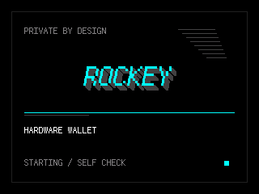

# PIN 输入与启动界面修复记录

日期：2026-10-11。

## 问题与处理

解锁页的轮盘状态会随 A/C 按键变化，但绘制使用 `{' ', '0', 当前数字}` 数组的第二个字符，只画一个字符，因此始终显示固定的 `0`。现在设置 PIN、重复确认 PIN、解锁均调用 `Coding/Rockey/device-ui/presentation.hpp` 的 `DrawPinRow`，直接画当前选择的数字；已输入数字、按键逻辑和 PIN 校验保持原有行为。

此前 `DrawBoot` 没有在初始化入口调用，存储、控制器和密码学自检期间只留下空屏。现在 `App::Begin` 在屏幕初始化完成后，立即绘制启动海报，再执行这些初始化。启动海报不会缩短初始化耗时；ROM、引导程序和屏幕驱动尚未就绪时无法由应用绘制。

海报使用已有英文等宽点阵字形：居中的 `ROCKEY` 放大三倍、按字形行斜切、低灰色多层投影、青色主字与分隔线，辅以 `PRIVATE BY DESIGN`、`HARDWARE WALLET`、`STARTING / SELF CHECK`。只绘制前景使阴影能正确叠加，不增加图片、新字库、全屏缓冲或人为停留时间。ASCII 内置字体档位复用 TFT GLCD 字库进行放大；中文正式固件使用当前生成的点阵字库进行放大和斜切。

## 验证

- 原有主机测试 1576 项通过。
- 字体像素与宽度对照 22 组通过。
- PIN 0–9 × 六个位置，共 60 组像素结果与固定源字体独立绘制结果一致。
- 构建入口的语法和 USB 线缆编码检查通过。
- 中文正式固件编译和发布 ELF 扫描通过，无测试按键入口。
- 启动画面已检查软件 framebuffer 彩色预览；实体按钮与屏幕效果等待用户确认。

测试调用真实产品绘制函数，只把 TFT 输出接到软件像素画布，不模拟钱包授权、存储或密码学成功。

## 固件记录

中文正式构建 ID：`20261010T233223Z-0179794`。后缀表示基础提交；本次修改尚未提交 Git。

固件大小：`1095600` 字节。SHA-256：`694beaa1ff09456ae4209d8dff61a40d6df137be092dfc313339b97208d80434`。

已刷入 M5，esptool 回读校验通过并自动重启。只写 app0，当前 NVS、分区表及钱包 LittleFS 已备份，未擦除钱包数据。设备数据备份保留于本机私有目录 `/Users/david/.codex/private/rockey-backups/before-pin-logo-20261010T233307Z`，不提交到仓库。实体屏幕、A/C 增减数字及启动观感仍待用户确认。
